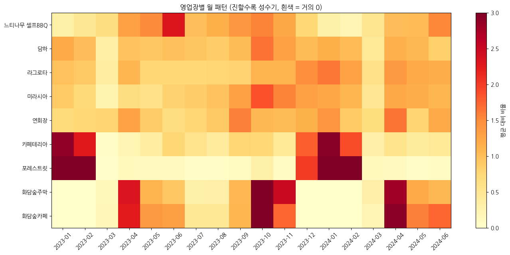
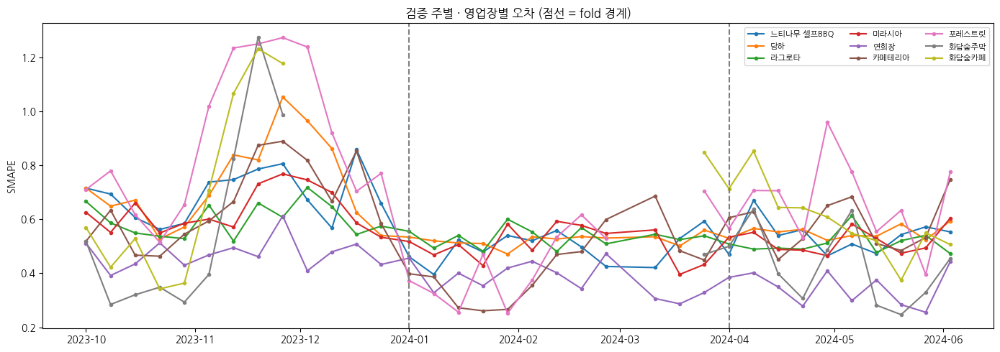

# 🏨 리조트 식음업장 메뉴별 1주일 수요 예측

> 캡스톤디자인 프로젝트 · 주제 출처: DACON × LG Aimers 「식음업장 메뉴 수요 예측 AI 온라인 해커톤」
> (대회 종료 후 학교 프로젝트로 진행)

**핵심 메시지:** 평가지표와 리조트의 계절 구조를 이해하고 설계한 수요 예측 모델

📘 **전체 정리 (개념 설명, 주차별 결과, 깨달음, 실수와 수정 과정):** [`PROJECT_SUMMARY.md`](PROJECT_SUMMARY.md)
📒 **주차별 진행 기록:** [`update.md`](update.md)

## 1. 프로젝트 개요

리조트 식음업장은 계절·요일·단체 행사에 따라 수요가 크게 변합니다.
식자재를 많이 준비하면 **폐기 손실**, 적게 준비하면 **품절로 인한 매출 손실**이 생깁니다.

본 프로젝트는 과거 판매 기록만으로 **메뉴별 향후 7일 판매량을 예측하는 모델**을 개발합니다.

- **입력:** 최근 28일간 메뉴별 일별 판매량
- **출력:** 다음 7일(+1일 ~ +7일)의 메뉴별 일별 판매량

## 2. 데이터

| 파일 | 내용 |
|------|------|
| `train/train.csv` | 2023-01-01 ~ 2024-06-15, 9개 영업장 · 193개 메뉴의 일별 매출수량 (102,676행) |
| `test/TEST_00 ~ 09.csv` | 각 28일치 입력 (2024-06 ~ 2025-05 사이 약 5주 간격, 1년에 걸쳐 분포) |
| `sample_submission.csv` | 각 TEST 구간의 +1일 ~ +7일 예측 제출 양식 |

- 변수: `영업일자`, `영업장명_메뉴명`, `매출수량`(타깃) — 날씨·예약률 등 외부 데이터 없음
- 원본 데이터는 저장소에 포함하지 않음 → [`data/README.md`](data/README.md)

## 3. 평가 지표 & 규칙

- **SMAPE** (0 = 완벽, 2 = 최악, 낮을수록 좋음). 대회는 영업장별 가중치(비공개)를 적용
- **실제 판매량이 0인 날은 평가에서 제외**
- 예측 시 **각 TEST 파일의 28일 데이터만** 입력으로 사용 가능
- 자체 검증은 영업장 가중치를 동일하게 두고 계산

## 4. 결과 한눈에 보기

```
흔한 방법(최근 7일 평균)   0.874
LightGBM 기본             0.794
+ 판매일만 학습            0.556   ← 평가 방식 이해 (가장 큰 개선)
+ dayofyear 제거           0.541   ← 날짜 외우기 제거
+ 과적합 방지 설정          0.534   ← 모델 단순화 (현재 최종)
```

| 모델 | fold1 (10~12월) | fold2 (1~3월) | fold3 (4~6월) | 평균 SMAPE ↓ |
|------|:----:|:----:|:----:|:----:|
| 규칙: 최근 7일 평균 | 0.741 | 1.075 | 0.805 | 0.874 |
| 규칙: 최근 28일 판매일 중앙값 | 0.626 | 0.818 | 0.561 | 0.668 |
| LightGBM (모든 날 학습) | 0.882 | 0.732 | 0.766 | 0.794 |
| LightGBM (판매일만 학습) | 0.642 | 0.505 | 0.521 | 0.556 |
| + dayofyear 제거 | 0.593 | 0.508 | 0.522 | 0.541 |
| **+ 과적합 방지 설정 (최종)** | **0.584** | **0.499** | **0.519** | **0.534** |

모든 실험 점수: [`results/experiment_log_all.csv`](results/experiment_log_all.csv)

## 5. 주요 인사이트



1. **판매 기록의 52.6%가 0인데, 0인 날은 채점하지 않는다** → "팔린다면 몇 개?"를 맞히도록 판매일만 학습 → 오차 대폭 감소. 피처 중요도에서도 "팔린 날 평균 판매량"이 60% 이상
2. **영업장마다 성수기가 정반대** — 스키 시즌 업장(겨울)과 수목원 업장(봄·가을, 겨울 휴장) → 계절별 3-fold 검증
3. **휴장 가게의 메뉴는 혼자 안 팔리던 메뉴보다 다시 팔릴 확률이 5배 이상** (12.8% vs 2.3%)
4. **어려운 메뉴는 많이 팔리는 메뉴가 아니라 들쭉날쭉한 메뉴** (변동계수 상관 +0.54). 단체 메뉴가 특히 어려움
5. **"데이터 양"보다 "작년 같은 계절"이 중요** — 학습 기간에 작년 봄이 들어가자 봄 예측이 급개선
6. **정보를 더하는 것보다 모델을 단순하게 만드는 게 효과적** — 새 피처 4종은 두 번 시험해도 효과 없음, 과적합 방지 설정은 3개 fold 모두 개선



## 6. 방법

**① 평가지표 맞춤 설계** — 0인 날은 채점되지 않으므로 판매일 샘플만으로 학습, 타깃은 log(1+판매량)

**② 검증 설계** — 계절별 3-fold Expanding-window (각 fold는 그 이전 데이터로만 학습, 검증 기간 안에서 매주 "28일 → 7일" 예측 반복)

| fold | 학습 | 검증 기간 | 들어 있는 시즌 전환 |
|------|------|-----------|-------------------|
| 1 | ~2023-09 | 2023-10 ~ 12 | 단풍 → 화담숲 휴장, 스키 시즌 시작 |
| 2 | ~2023-12 | 2024-01 ~ 03 | 스키 성수기 → 3월 휴식기 |
| 3 | ~2024-03 | 2024-04 ~ 06 | 봄 성수기 → 초여름 |

**③ "진짜 개선" 판정 규칙** — 모든 실험을 시드 3개로 반복해 흔들림을 측정하고, 평균이 흔들림의 2배 이상 좋아지면서 어느 fold도 나빠지지 않을 때만 채택. 봄(fold3)이 나빠지면 별도 경고

**④ 피처** — Lag, 최근 평균·팔린 날 평균·판매 비율, 같은 요일 값, 요일·월·공휴일, 메뉴·영업장 (날짜를 외우는 dayofyear는 제외)

**⑤ 모델** — 규칙 베이스라인 → LightGBM (과적합 방지 설정, 시드 3개 평균) → 4주차 CatBoost·앙상블

## 7. 폴더 구조

```
.
├── README.md
├── PROJECT_SUMMARY.md                   # 전체 정리
├── update.md                            # 주차별 진행 기록
├── requirements.txt
├── data/                                # 데이터 (저장소 미포함)
├── notebooks/
│   ├── 01_EDA.ipynb                     # 1주차 탐색적 데이터 분석
│   ├── 02_baseline.ipynb                # 1주차 베이스라인
│   ├── 03_error_analysis.ipynb          # 2주차 오차 분석 & 진단
│   ├── 04_feature_experiments.ipynb     # 3주차 피처 실험
│   ├── 05_retest_on_simple_model.ipynb  # 3주차 보충: 단순한 모델에서 재시험
│   └── 06_change_and_reduce.ipynb       # 3주차 보충: 바꾸기·줄이기
├── figures/                             # 그래프
├── results/                             # 점수표
└── submissions/                         # 제출 파일 (저장소 미포함)
```

## 8. 실행 방법

**Google Colab (권장)**
1. 구글 드라이브에 `capstone/` 폴더를 만들고 `notebooks/`, `data/`를 위 구조대로 배치
2. 노트북을 Colab으로 열어 `런타임 → 모두 실행` (첫 셀에서 드라이브 연결)

**로컬**
```bash
pip install -r requirements.txt
jupyter notebook   # notebooks/ 01 → 06 순서
```

## 9. 진행 현황

| 주차 | 내용 | 상태 |
|------|------|:----:|
| 1주차 | 문제 정의, EDA, 베이스라인 구축 | ✅ |
| 2주차 | 오차 분석, "진짜 개선" 판정 규칙, dayofyear 제거 | ✅ |
| 3주차 | 피처 개선 실험 + 보충 실험 2개, 과적합 방지 설정 채택 | ✅ |
| 4주차 | 중간값 학습 재판정, CatBoost, 앙상블 | ⬜ |
| 5주차 | 모델 해석 (SHAP), 운영 활용 방안 | ⬜ |
| 6주차 | 최종 정리 및 발표 | ⬜ |

## 10. 한계

- 재개장 직후 수요를 절반만 예측 (실제 37 vs 예측 약 18) → 운영 일정 같은 외부 데이터가 있으면 개선 가능
- 여름(7~9월)은 학습 데이터 부족으로 검증하지 못함
- 대회의 영업장 가중치가 비공개라 자체 점수와 대회 점수가 다를 수 있음

## 11. 기대 효과

- 메뉴별 필요 수량 파악 → 식자재 폐기·재고 비용 절감
- 주말·성수기·단체 수요 사전 파악 → 인력 배치 효율화
- 인기 메뉴 조기 품절 방지 → 고객 만족도 향상 및 매출 손실 감소
