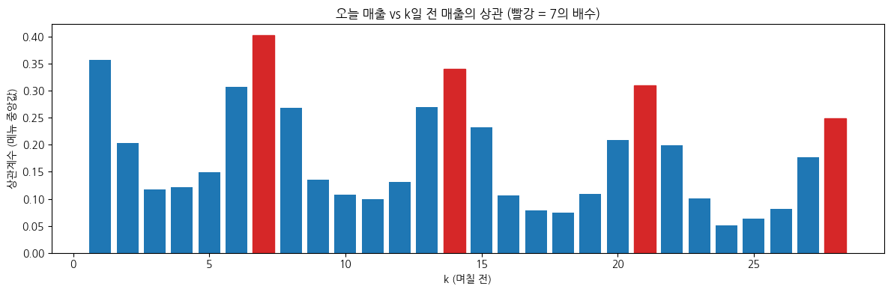

# 🏨 리조트 식음업장 메뉴별 1주일 수요 예측

> 캡스톤디자인 프로젝트 · 주제 출처: DACON × LG Aimers 「식음업장 메뉴 수요 예측 AI 온라인 해커톤」
> (대회 종료 후 학교 프로젝트로 진행)

**핵심 메시지:** 평가지표와 리조트의 계절 구조를 이해하고 설계한 수요 예측 모델

## 1. 프로젝트 개요

리조트 식음업장은 계절·요일·단체 행사에 따라 수요가 크게 변합니다.
식자재를 많이 준비하면 **폐기 손실**, 적게 준비하면 **품절로 인한 매출 손실**이 생깁니다.

본 프로젝트는 과거 판매 기록만으로 **메뉴별 향후 7일 판매량을 예측하는 모델**을 개발하는 **예측 모델링 중심 프로젝트**입니다.

- **입력:** 최근 28일간 메뉴별 일별 판매량
- **출력:** 다음 7일(+1일 ~ +7일)의 메뉴별 일별 판매량

## 2. 데이터

| 파일 | 내용 |
|------|------|
| `train/train.csv` | 2023-01-01 ~ 2024-06-15, 9개 영업장 · 193개 메뉴의 일별 매출수량 (102,676행) |
| `test/TEST_00 ~ 09.csv` | 각 28일치 입력 (2024-06 ~ 2025-05 사이 약 5주 간격, 1년에 걸쳐 분포) |
| `sample_submission.csv` | 각 TEST 구간의 +1일 ~ +7일 예측 제출 양식 |

- 변수: `영업일자`, `영업장명_메뉴명`, `매출수량`(타깃) — 날씨·예약률 등 외부 데이터 없음
- 원본 데이터는 저장소에 포함하지 않음 → [`data/README.md`](data/README.md)

## 3. 평가 지표 & 규칙

- **SMAPE** (0 = 완벽, 2 = 최악, 낮을수록 좋음). 대회는 영업장별 가중치(비공개)를 적용
- **실제 판매량이 0인 날은 평가에서 제외**
- 예측 시 **각 TEST 파일의 28일 데이터만** 입력으로 사용 가능
- 본 프로젝트의 자체 검증은 영업장 가중치를 동일하게 두고 계산

## 4. 주요 인사이트 (EDA)


1. **영업장마다 성수기가 정반대인 시즌 구조**
   - 포레스트릿·카페테리아: 12~2월 성수기 (포레스트릿은 1월에 평소의 3.8배), 나머지 기간 거의 0
   - 화담숲주막·화담숲카페: 12~2월 휴장, 4월·10월 성수기
   - 3월 초·중순 약 2주간 리조트 전체 판매가 거의 0
2. **판매 기록의 52.6%가 0** — 판매일 비율 50% 미만인 메뉴가 109개 (193개 중)
3. **요일 효과:** 평일 대비 주말 1.5배, 공휴일 1.8배. 단, BBQ·연회장은 목요일에 몰림 (단체 수요)
4. **7일 주기:** 7일 전 판매량(상관 0.40)이 어제 판매량(0.36)보다 오늘과 더 비슷함



## 5. 방법

**① 평가지표 맞춤 설계** — 0인 날은 채점되지 않으므로 "팔린다면 몇 개인가"를 예측하도록 **판매일 샘플만으로 학습**

**② 검증 설계** — TEST가 1년에 걸쳐 있으므로 계절별 3-fold Expanding-window 검증 (각 fold는 그 이전 데이터로만 학습)

| fold | 학습 | 검증 기간 |
|------|------|-----------|
| 1 | ~2023-09 | 2023-10 ~ 12 |
| 2 | ~2023-12 | 2024-01 ~ 03 |
| 3 | ~2024-03 | 2024-04 ~ 06 |

**③ 피처** — Lag 1~28, 같은 요일 Lag·평균, 최근 7/14/28일 평균·판매일 평균·판매일 비율, 마지막 판매 후 경과일, 요일·월·연중일자·공휴일, 메뉴·영업장

**④ 모델** — 규칙 기반 베이스라인 → LightGBM (이후 CatBoost·딥러닝 비교 및 앙상블 예정)

## 6. 결과

| 모델 | fold1 | fold2 | fold3 | 평균 SMAPE ↓ |
|------|:----:|:----:|:----:|:----:|
| **LightGBM (판매일만 학습)** | 0.638 | 0.508 | 0.521 | **0.556** |
| 규칙: 최근 28일 판매일 중앙값 | 0.626 | 0.818 | 0.561 | 0.668 |
| LightGBM (모든 날 학습) | 0.882 | 0.732 | 0.766 | 0.794 |
| 규칙: 최근 7일 평균 | 0.741 | 1.075 | 0.805 | 0.874 |
| 규칙: 최근 4주 같은 요일 평균 | 0.881 | 1.056 | 0.885 | 0.941 |

- 같은 LightGBM이라도 **학습 데이터를 판매일로 바꾸는 것만으로 0.794 → 0.556** — 평가지표 이해가 가장 큰 개선 요인
- 오차가 큰 구간: **시즌 전환 시점** (화담숲 3월 재개장, 포레스트릿 12월 시즌 시작)

## 7. 폴더 구조

```
.
├── README.md
├── update.md                  # 주차별 진행 기록
├── requirements.txt
├── data/                      # 데이터 (저장소 미포함)
├── notebooks/
│   ├── 01_EDA.ipynb           # 탐색적 데이터 분석
│   └── 02_baseline.ipynb      # 베이스라인 모델
├── figures/                   # 그래프
├── results/                   # 점수표
└── submissions/               # 제출 파일 (저장소 미포함)
```

## 8. 실행 방법

**Google Colab (권장)**
1. 구글 드라이브에 `capstone/` 폴더를 만들고 `notebooks/`, `data/`를 위 구조대로 배치
2. 노트북을 Colab으로 열어 위에서부터 실행 (첫 셀에서 드라이브 연결)

**로컬**
```bash
pip install -r requirements.txt
jupyter notebook   # notebooks/01_EDA.ipynb → 02_baseline.ipynb 순서
```

## 9. 진행 현황

| 주차 | 내용 | 상태 |
|------|------|:----:|
| 1주차 | 문제 정의, EDA, 베이스라인 구축 | ✅ |
| 2주차 | 오차 분석 (시즌 전환 구간, 영업장별) | ⬜ |
| 3주차 | 피처 개선 (시즌·휴장 피처, 메뉴 그룹) | ⬜ |
| 4주차 | 모델 비교 (CatBoost, 딥러닝) 및 앙상블 | ⬜ |
| 5주차 | 모델 해석 (SHAP), 운영 관점 활용 방안 | ⬜ |
| 6주차 | 최종 정리 및 발표 | ⬜ |

자세한 기록 → [`update.md`](update.md)

## 10. 기대 효과

- 메뉴별 필요 수량 파악 → 식자재 폐기·재고 비용 절감
- 주말·성수기·단체 수요 사전 파악 → 인력 배치 효율화
- 인기 메뉴 조기 품절 방지 → 고객 만족도 향상 및 매출 손실 감소
